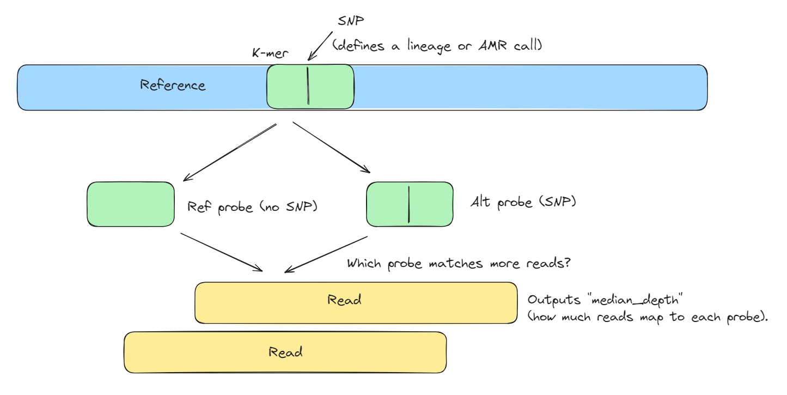

Mykrobe (<https://www.nature.com/articles/ncomms10063>) is used for lineage calling. The mycobacterial pipeline **only **makes use of Mykrobe outputs for predicting “**lineage**” of samples (which have already been deemed likely to contain sufficient mycobacterial by the [Gatekeeper](gatekeeper.qmd) step. It is not used for AMR predictions.

# Thresholds

Software developed by close collaborators. Any relevant information on thresholds can be found in the mykrobe readme. Mykrobe version can be found by checking poller release information for the deployed version e.g. <https://github.com/GlobalPathogenAnalysisService/gpas-poller/releases/tag/1.23.16> 

# How it works

Sets of k-mer probes (panels) are provided with the mykrobe software (run `mykrobe panels describe` for details). These come in pairs with one probe sequence drawn exactly from the reference genome and another with a SNP at a location indiciative of an important change (e.g. to species, lineage or antimicrobial resistance - <https://github.com/Mykrobe-tools/mykrobe/issues/94>), but otherwise identical to the reference. During execution, these are mapped to input reads (fastq files). The number of times the reference probe maps is compared with the number of times the alternative probe is mapped to make a call on whether the SNP was present in the sample genome(s).



The mycobacterial pipeline **only **makes use of Mykrobe outputs for predicting “**lineage**” of samples (which have already been deemed likely to contain sufficient mycobacterial by the [Gatekeeper](gatekeeper.qmd) step. It is not used for AMR predictions. Here, we define lineage as a key in the JSON data output by Mykrobe (e.g. below). In the case of non-tuberculosis mycobacteria (NTM), this will likely be an indication of subspecies, not lineage *per se*. For members of the TB-complex, it will likely be a lineage in the sense that this term is used by the TB clinical and academic community. The full species name to be returned to users is worked out by a later workflow step combining data from Competitive Mapping and Lineage Calling ([Summary](summary.qmd)).

# Output Terminology

| **Term** | **Definition** |
| --- | --- |
| `percent_coverage` | The percentage of the bases in the probe that have non-zero coverage. |

# Example outputs

*Example output NTM:*

```
{
  "phylo_group": {
    "Non_tuberculosis_mycobacterium_complex": {
      "percent_coverage": 71.839,
      "median_depth": 3,
      "inferred_from_child": true
    }
  },
  "sub_complex": {
    "subNon_tuberculosis_mycobacterium_complex": {
      "percent_coverage": 71.839,
      "median_depth": 3,
      "inferred_from_child": true
    }
  },
  "species": {
    "Mycobacterium_abscessus": {
      "percent_coverage": 71.839,
      "median_depth": 3
    }
  },
  "lineage": {
    "Mycobacterium_abscessus_subsp._abscessus": {
      "percent_coverage": 64.768,
      "median_depth": 3
    }
  }
}
```

*Example output TB (truncated):*

```
{
  "phylo_group": {
    "Mycobacterium_tuberculosis_complex": {
      "percent_coverage": 99.602,
      "median_depth": 110,
      "inferred_from_child": true
    }
  },
  "sub_complex": {
    "subMycobacterium_tuberculosis_complex": {
      "percent_coverage": 99.602,
      "median_depth": 110
    }
  },
  "species": {
    "Mycobacterium_tuberculosis": {
      "percent_coverage": 98.709,
      "median_depth": 110
    }
  },
  "lineage": {
    "lineage": [
      "lineage4.3.4.2"
    ],
    "calls_summary": {
      "lineage4.3.4.2": {
        "good_nodes": 4,
        "tree_depth": 4,
        "genotypes": {
          "lineage4": 1,
          "lineage4.3": 1,
          "lineage4.3.4": 1,
          "lineage4.3.4.2": 1
        }
      }
    },
    "calls": {
      "lineage4.3.4.2": {
        "lineage4": {
          "T931123C": {
            "variant": "ref-T931123C?var_name=T931123C&num_alts=1&ref=NC_000962.3&enum=0&gene=NA&mut=T931123C",
            "genotype": [
```
