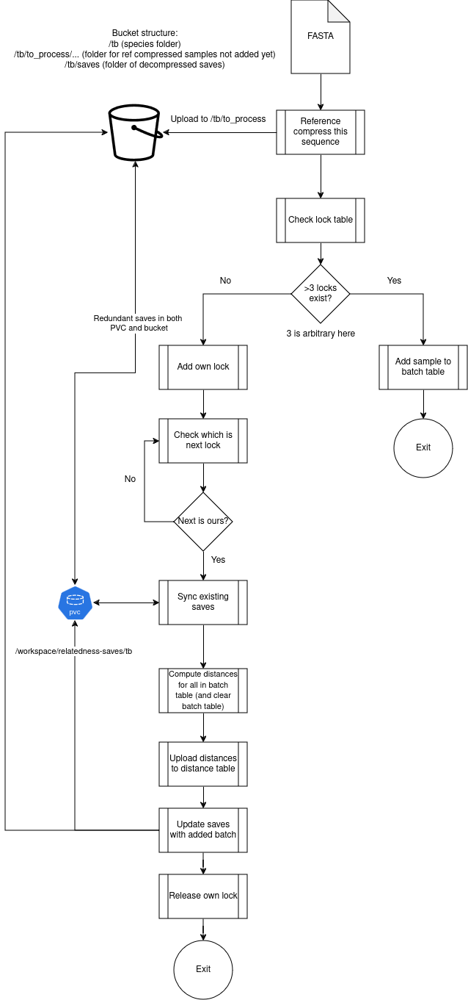

For relatedness we use `findNeighbour5`, an MMM developed and maintained project. The basis of this software is SNP distance calculation from a fixed length FASTA file.

### For each sample processed

1. Load a reference genome’s FASTA file
2. Load a mask (for ignoring repetitive or highly variable regions)
3. Parse the sample’s FASTA file, comparing with the reference genome.   
If a sample != reference at an unmasked base (and the sample is also not N) FASTA file, comparing with the reference genome.   
If a sample != reference at an unmasked base (and the sample is also not N) FASTA file, comparing with the reference genome.   
If a sample != reference at an unmasked base, the position is stored (as well as what the sample was). For simplicity, we use 1 list for each nucleotide, including N
4. A save file of these positions (arranged by nucleotide) is saved to disk
5. Each pre-existing sample’s saves is then loaded from disk, comparing against the new sample’s save. If the distance is above a user definable cutoff, the distance calculation stops early (for efficiency)
6. The new sample’s save is then moved into the list of samples to compare about

# Thresholds

- QC threshold of 80% ACGT within FASTA file regardless of species
- Computational threshold of max SNPs depends on species. This is driven from epidemiologically important thresholds. A little extra headroom is given for clustering
- TB: calculated to 20 SNPs, reported within portal column to 12 SNPs (up to 20 is reported within relatedness section)

##  In more detail

